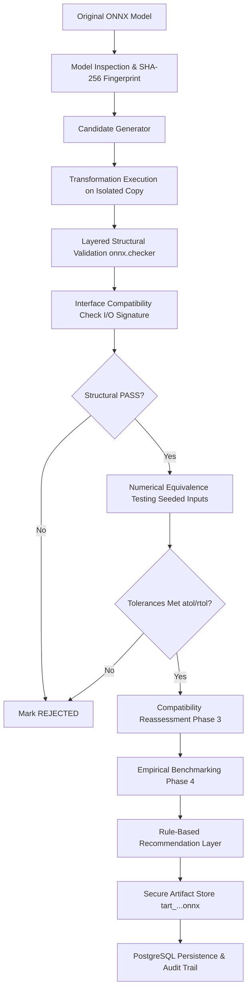
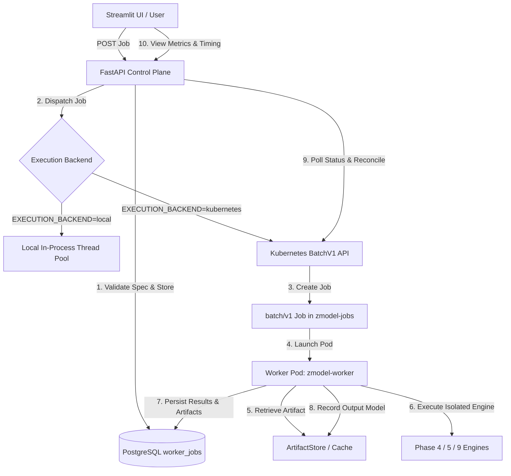

# Z-ModelPilot

**Architecture-Aware AI Model Deployment Analysis & Optimization**

Z-ModelPilot is an enterprise-oriented developer platform designed to inspect ONNX neural networks, evaluate target architecture compatibility with explainable evidence, profile empirical execution benchmarks, select Pareto-optimal deployment configurations based on measured facts, maintain durable PostgreSQL experiment histories, and expose all core engines through a production-hardened FastAPI REST API.

---

## Current Status: Phase 12 Released (Advanced Model Optimization & Enterprise Reporting v1.4.0)

Phase 12 transforms Z-ModelPilot into an evidence-driven **Engineering Decision-Support System** (`v1.4.0`):

- **Bounded Multi-Strategy Configuration Search**: Supports deterministic `GRID` search, seeded `RANDOM` exploration, and multi-fidelity `SUCCESSIVE_HALVING` (screening candidates with early iterations and halving before full benchmarks) across execution providers, thread topologies, batch sizes, graph optimization levels, and execution modes.
- **Mathematical 4-Objective Pareto Frontier Engine**: Evaluates strict mathematical dominance across latency, throughput, memory, and resource usage. Correctly flags incomparable candidates, handles ties, preserves trade-offs, and provides explicit diagnostic explanations when constraints exclude all candidates.
- **Measurement Reliability & Stability Analysis**: Computes interquartile range (IQR), standard deviation, sample counts, and coefficient of variation (CV%) on latency distributions, assigning statistical ratings (`HIGH`, `MODERATE`, `UNSTABLE`) and explicitly flagging unmeasured or small-sample metrics.
- **Empirical Sensitivity Analysis**: Quantifies batch size scaling elasticity, intra-op thread parallel scaling saturation, and parameter variance attribution from actual benchmark observations without causal overclaims.
- **Evidence-Based Recommendation Engine**: Evaluates candidates against user goals (`MINIMIZE_LATENCY`, `MAXIMIZE_THROUGHPUT`, `MINIMIZE_MEMORY`, `BALANCED_SCORE`) with transparent normalized utility scoring (40% latency, 40% throughput, 20% memory), baseline speedup deltas, and strict correctness gating.
- **Enterprise 18-Section Audit Reports**: Generates professional, reproducible deployment optimization reports in Markdown and schema-validated JSON formats (`2.0.0-phase12`), complete with automated secret/credential redaction, hardware provenance disclosures, and SHA-256 integrity digests.
- **Interactive Streamlit Decision Workspace**: 5-tab interface for Pareto frontier exploration, candidate comparative analysis, parameter sensitivity curves, recommendation rationale inspection, and enterprise report preview and export.
- **FastAPI Decision Endpoints**: Exposes 5 REST API endpoints (`POST /api/v1/optimizations/search`, `GET /pareto`, `GET /sensitivity`, `GET /recommendation`, `GET /report`) with request validation, candidate bounds, and authorization isolation.
- **100% Passing Test Suite**: 221 automated unit, integration, persistence, API, and regression tests passing cleanly across all 12 phases.

---

## Architecture & System Pipeline

Z-ModelPilot strictly separates concerns into a modular eleven-stage pipeline:

| Phase | Boundary | Engine / Module | Primary Responsibility |
|---|---|---|---|
| **Phase 1** | Workspace Shell | [`src/zmodel/ui/`](file:///d:/zmodel/src/zmodel/ui/) | Design system, session state, navigation, sample model generators. |
| **Phase 2** | Static Graph Inspection | [`src/zmodel/core/model_loader.py`](file:///d:/zmodel/src/zmodel/core/model_loader.py) | In-memory ONNX validation, tensor shapes, opset versions, SHA-256 fingerprinting. |
| **Phase 3** | Capability Matching | [`src/zmodel/core/compatibility.py`](file:///d:/zmodel/src/zmodel/core/compatibility.py) | Target capability profiles, deterministic assessment policy, explainable audit findings. |
| **Phase 4** | Empirical Benchmarking | [`src/zmodel/core/benchmark.py`](file:///d:/zmodel/src/zmodel/core/benchmark.py) | Monotonic high-res timing, correctness smoke testing, percentiles, throughput, memory RSS. |
| **Phase 5** | Runtime Config Optimization | [`src/zmodel/core/optimizer.py`](file:///d:/zmodel/src/zmodel/core/optimizer.py) | Runtime configuration tuning (threads, batch size), Pareto frontier, ranking. |
| **Phase 6** | Persistence & History | [`src/zmodel/db/`](file:///d:/zmodel/src/zmodel/db/) | PostgreSQL persistence, Alembic migrations, connection pooling, model registry, fair comparator. |
| **Phase 7** | REST API & Deployment | [`src/zmodel/api/`](file:///d:/zmodel/src/zmodel/api/) | FastAPI endpoints (`/api/v1`), bounded job manager (`202 Accepted`), Docker Compose, GitHub Actions CI. |
| **Phase 8** | E2E Testing & Release | [`tests/test_e2e.py`](file:///d:/zmodel/tests/test_e2e.py), [`demo_walkthrough.py`](file:///d:/zmodel/demo_walkthrough.py) | End-to-end validation (Workflows A-F), UI polish, Settings view, portfolio demo script. |
| **Phase 9** | Graph Optimization Engine | [`src/zmodel/core/graph_optimizer.py`](file:///d:/zmodel/src/zmodel/core/graph_optimizer.py) | Graph-level operator fusion, constant folding, shape inference, numerical equivalence, artifact store. |
| **Phase 10** | Kubernetes Benchmark Workers | [`src/zmodel/core/execution/`](file:///d:/zmodel/src/zmodel/core/execution/), [`src/zmodel/worker/`](file:///d:/zmodel/src/zmodel/worker/) | Kubernetes Job execution backend, containerized worker, resource limits, timing breakdown, RBAC manifests. |
| **Phase 11** | IBM Z Target Validation | [`src/zmodel/core/validation_engine.py`](file:///d:/zmodel/src/zmodel/core/validation_engine.py), [`src/zmodel/core/environment.py`](file:///d:/zmodel/src/zmodel/core/environment.py), [`src/zmodel/core/target_runner.py`](file:///d:/zmodel/src/zmodel/core/target_runner.py) | 12-point validation engine, environment inventory, target profiles, SSH runner boundary, hardware provenance. |
| **Phase 12** | Advanced Optimizer & Reporting | [`src/zmodel/core/advanced_optimizer.py`](file:///d:/zmodel/src/zmodel/core/advanced_optimizer.py), [`src/zmodel/ui/views/optimization.py`](file:///d:/zmodel/src/zmodel/ui/views/optimization.py) | Multi-strategy search, 4-objective Pareto ranking, measurement reliability, sensitivity, 18-section audit reports. |

---

## Phase 7: REST API Specification

Interactive OpenAPI documentation is automatically served at:
- Swagger UI: `http://localhost:8000/docs`
- ReDoc: `http://localhost:8000/redoc`
- OpenAPI JSON: `http://localhost:8000/openapi.json`

### Endpoint Summary

| Category | HTTP Method & Path | Status Code | Description |
|---|---|---|---|
| **Health** | `GET /health/live` | `200` | Process liveness probe. |
| **Health** | `GET /health/ready` | `200 / 503` | Readiness probe checking database connectivity and table counts. |
| **Models** | `POST /api/v1/models/inspect` | `200` | Multipart upload for ONNX graph inspection and SHA-256 fingerprinting. |
| **Models** | `GET /api/v1/models` | `200` | List registered model identities from PostgreSQL. |
| **Models** | `GET /api/v1/models/{fingerprint}` | `200 / 404` | Retrieve registered model identity by SHA-256 fingerprint. |
| **Compatibility** | `GET /api/v1/compatibility/profiles` | `200` | List available versioned capability profiles (ruleset versions, opsets). |
| **Compatibility** | `GET /api/v1/compatibility/profiles/{id}` | `200 / 404` | Get profile details and supported operator rules count. |
| **Compatibility** | `POST /api/v1/compatibility/analyze` | `200` | Evaluate model compatibility with PASS/FAIL/WARNING/UNKNOWN findings. |
| **Benchmarks** | `POST /api/v1/benchmarks` | `202` | Queue bounded empirical benchmark job in worker thread pool. |
| **Benchmarks** | `GET /api/v1/benchmarks/{id}/status` | `200 / 404` | Query benchmark job lifecycle state (`QUEUED`, `RUNNING`, `COMPLETED`, `FAILED`). |
| **Benchmarks** | `GET /api/v1/benchmarks/{id}` | `200 / 404` | Retrieve full benchmark report with latency percentiles and throughput. |
| **Benchmarks** | `GET /api/v1/benchmarks` | `200` | List persisted benchmark executions with pagination and filtering. |
| **Optimization** | `POST /api/v1/optimizations` | `202` | Queue multi-candidate optimization experiment job. |
| **Optimization** | `GET /api/v1/optimizations/{id}/status` | `200 / 404` | Check optimization experiment lifecycle state and progress. |
| **Optimization** | `GET /api/v1/optimizations/{id}` | `200 / 404` | Get completed optimization report with winning configuration & rationale. |
| **Optimization** | `GET /api/v1/optimizations/{id}/candidates` | `200 / 404` | Retrieve itemized candidates, speedups, and Pareto classifications. |
| **Experiments** | `GET /api/v1/experiments` | `200` | List historical optimization experiments from PostgreSQL. |
| **Experiments** | `GET /api/v1/experiments/{id}` | `200 / 404` | Retrieve experiment details with attached candidate summary counts. |
| **Experiments** | `GET /api/v1/experiments/{id}/candidates` | `200 / 404` | List evaluated candidates for a historical experiment. |
| **Experiments** | `POST /api/v1/experiments/compare` | `200 / 404` | Scientifically compare two empirical benchmark runs with validity checks. |
| **Graph Optimization** | `POST /api/v1/graph-optimizations` | `202` | Queue bounded graph optimization experiment (constant folding, fusion, shape inference). |
| **Graph Optimization** | `GET /api/v1/graph-optimizations/{id}/status` | `200 / 404` | Poll experiment progress and candidate lifecycle status. |
| **Graph Optimization** | `GET /api/v1/graph-optimizations/{id}` | `200 / 404` | Get full graph optimization report with candidate evaluations and recommendation. |
| **Graph Optimization** | `GET /api/v1/graph-optimizations/{id}/candidates` | `200 / 404` | List all transformation candidates, node deltas, and speedups. |
| **Graph Optimization** | `GET /api/v1/graph-optimizations/{id}/candidates/{cand_id}` | `200 / 404` | Detailed candidate evaluation metrics and numerical validation statistics. |
| **Graph Optimization** | `GET /api/v1/graph-optimizations/{id}/candidates/{cand_id}/artifact` | `200 / 400 / 404` | Controlled download of validated transformed ONNX model artifact (rejects failing candidates). |
| **Worker Jobs** | `GET /api/v1/jobs/health` | `200` | Inspect execution backend status (local thread pool vs Kubernetes cluster connectivity). |
| **Worker Jobs** | `GET /api/v1/jobs` | `200` | Paginated listing of execution jobs with status, backend, and timing filters. |
| **Worker Jobs** | `GET /api/v1/jobs/{id}` | `200 / 404` | Detailed execution job status with timing breakdown and persisted result payload. |
| **Worker Jobs** | `POST /api/v1/jobs/{id}/cancel` | `200 / 404` | Request cancellation and cleanup of an active or queued worker job. |
| **IBM Z Validation** | `GET /api/v1/validation/environment` | `200` | Inspect verified environment facts, CPU architecture, providers, and fingerprint. |
| **IBM Z Validation** | `GET /api/v1/validation/profiles` | `200` | List versioned target validation profiles (`ibm_z16_linux_nnpa`, `ibm_z_linux_cpu`, etc.). |
| **IBM Z Validation** | `GET /api/v1/validation/profiles/{id}` | `200 / 404` | Retrieve detailed target profile requirements and evidence citations. |
| **IBM Z Validation** | `POST /api/v1/validation/evaluate` | `200` | Execute 12-check validation battery against selected target profile. |
| **IBM Z Validation** | `GET /api/v1/validation/runs` | `200` | Paginated listing of persisted validation run audit records. |
| **IBM Z Validation** | `GET /api/v1/validation/runs/{id}` | `200 / 404` | Retrieve full validation report, check results, evidence, and remediation hints. |
| **Advanced Optimization** | `POST /api/v1/optimizations/search` | `202` | Queue bounded advanced optimization search job (Grid, Random, Successive Halving). |
| **Advanced Optimization** | `GET /api/v1/optimizations/{id}/pareto` | `200 / 404` | Retrieve 4-objective Pareto-frontier candidates with trade-off analysis. |
| **Advanced Optimization** | `GET /api/v1/optimizations/{id}/sensitivity` | `200 / 404` | Retrieve empirical batch and thread sensitivity curves with variance attribution. |
| **Advanced Optimization** | `GET /api/v1/optimizations/{id}/recommendation` | `200 / 404` | Retrieve goal-driven recommendation with baseline deltas and rationale. |
| **Advanced Optimization** | `GET /api/v1/optimizations/{id}/report` | `200 / 404` | Export reproducible 18-section audit report in Markdown or schema-validated JSON format. |

---

## Phase 9: ONNX Graph Optimization & Model Transformation Engine

### 1. Conceptual Distinction: Graph Transformations vs Runtime Configuration Tuning

Z-ModelPilot models two fundamentally different categories of optimization:

- **Phase 5 Runtime Configuration Optimization**: Tunes execution provider parameters, thread counts (intra/inter-op), and batch sizes. The model binary and computational graph topology remain completely untouched.
- **Phase 9 Graph-Level Model Optimization**: Directly inspects and transforms the ONNX graph structure—evaluating constant subgraphs, fusing operations into composite kernels, eliminating dead code, and propagating tensor value information. It outputs a new, cryptographically fingerprinted ONNX binary artifact.

### 2. End-to-End Transformation Pipeline



### 3. Supported Real Graph Transformations

All transformations perform capability checks before execution and honestly report whether a graph change occurred:

1. **Static Shape & Type Inference (`shape_inference`)**:
   - Tool: `onnx.shape_inference` (`onnx==1.23.2`)
   - Propagates static shapes across all intermediate tensors (`graph.value_info`). Essential for sizing memory buffers before target deployment.
2. **ONNX Runtime Basic Optimization (`ort_basic`)**:
   - Tool: `onnxruntime` (`1.31.0`), level `ORT_ENABLE_BASIC`
   - Constant folding, dead node removal, and redundant reshape elimination across all execution providers.
3. **ONNX Runtime Extended Optimization (`ort_extended`)**:
   - Tool: `onnxruntime` (`1.31.0`), level `ORT_ENABLE_EXTENDED`
   - Operator fusions (e.g. `Gemm + Relu -> Gemm[alpha, beta]`, `Conv + Add -> Conv`). Explicitly flagged with host-environment disclosures.
4. **ONNX Runtime Full Optimization (`ort_all`)**:
   - Tool: `onnxruntime` (`1.31.0`), level `ORT_ENABLE_ALL`
   - Enables all available graph fusions and layout transformations (e.g. NCHW / NHWC memory layout tuning).
5. **ONNX Simplifier (`simplification`)**:
   - Tool: `onnxsim` (optional)
   - Evaluates constant subgraphs and redundant branches. If not installed, reports honest status: `"Transformation unavailable: onnxsim package is not installed."`

### 4. Layered Correctness & Numerical Validation

A transformed model is **never** considered successful merely because it loads or parses:

- **Structural Validation**: Verified with `onnx.checker.check_model(model, full_check=True)`. Validates operator domains, opset rules, and graph reference integrity.
- **Interface Compatibility**: Strictly confirms that input names, output names, tensor ranks, and data types are preserved.
- **Deterministic Numerical Equivalence**: Synthesizes identical input tensors using a fixed random seed (`seed=42`). Runs both the original and transformed models on the local runtime, computing:
  - $\text{Max Absolute Error} = \max |y_{\text{orig}} - y_{\text{trans}}|$
  - $\text{Mean Absolute Error} = \text{mean} |y_{\text{orig}} - y_{\text{trans}}|$
  - $\text{Max Relative Error} = \max \frac{|y_{\text{orig}} - y_{\text{trans}}|}{|y_{\text{orig}}| + 10^{-8}}$
  - Evaluated against configurable thresholds (default: `atol=1e-4`, `rtol=1e-3`).

### 5. Artifact Download Safety & Immutability

- Original models are strictly immutable.
- Transformed artifacts receive a new SHA-256 fingerprint and are saved to `artifacts/transformed/tart_<parent>_<transform>_<uid>.onnx`.
- Path traversal is strictly prevented using `os.path.realpath` checks against the storage root directory.
- Model binaries are never stored as database blobs; PostgreSQL stores metadata only.
- The artifact download endpoint (`GET /api/v1/graph-optimizations/{id}/candidates/{cand_id}/artifact`) rejects candidates that failed structural or numerical validation (`HTTP 400 Bad Request`).


---

## API Usage Examples (`curl`)

### 1. Model Inspection
```bash
curl -X POST "http://localhost:8000/api/v1/models/inspect" \
  -H "accept: application/json" \
  -H "Content-Type: multipart/form-data" \
  -F "file=@sample_models/linear_classifier.onnx"
```

*Response:*
```json
{
  "filename": "linear_classifier.onnx",
  "file_size_bytes": 3584,
  "sha256_fingerprint": "8d3e2...",
  "ir_version": 9,
  "producer_name": "Z-ModelPilot Generator",
  "producer_version": "0.1.0",
  "metadata": {
    "producer_name": "Z-ModelPilot Generator",
    "producer_version": "0.1.0",
    "model_version": 1,
    "ir_version": 9,
    "doc_string": "Sample verified ONNX model for deployment analysis.",
    "domain": "ai.onnx",
    "custom_metadata": {}
  },
  "opset_imports": [{"domain": "ai.onnx", "version": 17}],
  "inputs": [
    {
      "name": "input_features",
      "data_type": "float32",
      "shape": ["batch_size", 16],
      "rank": 2,
      "is_dynamic": true,
      "dynamic_dim_names": ["batch_size"],
      "dimension_description": "[batch_size, 16]"
    }
  ],
  "outputs": [
    {
      "name": "probabilities",
      "data_type": "float32",
      "shape": ["batch_size", 4],
      "rank": 2,
      "is_dynamic": true,
      "dynamic_dim_names": ["batch_size"],
      "dimension_description": "[batch_size, 4]"
    }
  ],
  "weights": [
    {"name": "fc1.weight", "data_type": "float32", "shape": [32, 16], "num_elements": 512, "size_bytes": 2048, "has_external_data": false}
  ],
  "total_nodes": 4,
  "total_parameters": 643,
  "total_weight_bytes": 2572,
  "operator_counts": {"Gemm": 2, "Relu": 1, "Softmax": 1},
  "has_external_data": false,
  "external_data_tensors": [],
  "warnings": []
}
```

### 2. Compatibility Analysis
```bash
curl -X POST "http://localhost:8000/api/v1/compatibility/analyze" \
  -H "Content-Type: application/json" \
  -d '{
    "sample_model_name": "linear_classifier.onnx",
    "profile_id": "local_onnx_runtime_cpu"
  }'
```

*Response:*
```json
{
  "assessment_id": "compat_8d3e23635397_local_onnx_runtime_cpu",
  "model_name": "linear_classifier.onnx",
  "model_fingerprint": "8d3e2...",
  "profile_id": "local_onnx_runtime_cpu",
  "profile_name": "Local ONNX Runtime (CPU)",
  "profile_version": "1.18.0",
  "ruleset_version": "1.0.0",
  "overall_assessment": "COMPATIBLE",
  "summary_counts": {
    "TOTAL": 6,
    "PASS": 6,
    "FAIL": 0,
    "WARNING": 0,
    "UNKNOWN": 0
  },
  "findings": [
    {
      "finding_id": "FIND-OP-000",
      "category": "operator",
      "status": "PASS",
      "severity": "INFO",
      "feature": "Gemm",
      "observed_value": "Opset 17",
      "profile_rule": "Supported in opsets 1 to 21",
      "explanation": "Operator 'Gemm' is fully supported by the CPUExecutionProvider profile.",
      "evidence_source": "ONNX Runtime 1.18.0 CPU Provider Documentation",
      "recommended_action": "No remediation required."
    }
  ],
  "is_illustrative_profile": false,
  "timestamp_utc": "2026-10-17T22:30:00+00:00"
}
```

### 3. Submitting an Asynchronous Benchmark Job
```bash
curl -X POST "http://localhost:8000/api/v1/benchmarks" \
  -H "Content-Type: application/json" \
  -d '{
    "sample_model_name": "linear_classifier.onnx",
    "config": {
      "execution_provider": "CPUExecutionProvider",
      "batch_size": 1,
      "warmup_iterations": 5,
      "measured_iterations": 20,
      "repeated_rounds": 1
    }
  }'
```

*Response (HTTP 202 Accepted):*
```json
{
  "job_id": "job-a48b9f10c3d2",
  "status": "QUEUED",
  "created_at": "2026-10-17T22:35:00+00:00",
  "message": "Benchmark execution job queued in bounded worker pool."
}
```

### 4. Querying Benchmark Job Status and Results
```bash
curl -X GET "http://localhost:8000/api/v1/benchmarks/job-a48b9f10c3d2/status"
```

*Response:*
```json
{
  "job_id": "job-a48b9f10c3d2",
  "status": "COMPLETED",
  "progress_pct": 100,
  "progress_message": "Execution completed successfully",
  "result": {
    "status": "SUCCESS",
    "latency": {
      "median_ms": 0.045,
      "p95_ms": 0.052,
      "min_ms": 0.038,
      "max_ms": 0.071
    },
    "throughput": {
      "inferences_per_second": 21850.4,
      "samples_per_second": 21850.4
    },
    "correctness": {
      "passed": true,
      "details": "Smoke inference succeeded with valid shapes, finite numerical outputs, and repeatable execution."
    }
  }
}
```

---

## Docker & Local Compose Deployment

The project includes container specifications for local orchestration:

```bash
# 1. Start full stack (PostgreSQL, FastAPI REST API, Streamlit UI)
docker compose up -d --build

# 2. Check service health
docker compose ps

# 3. Apply Alembic migrations against the PostgreSQL container
docker compose run --rm api alembic upgrade head

# 4. Access services
# FastAPI Interactive Docs: http://localhost:8000/docs
# Streamlit Human UI:       http://localhost:8501
# PostgreSQL Database:     localhost:5432 (user: zmodel_user, db: zmodel_db)

# 5. Stop the stack (preserves database data volume)
docker compose down

# 6. Stop and remove volumes (clean slate reset)
docker compose down -v
```

---

## Phase 10: Kubernetes-Based Benchmark Workers & Scalable Job Execution

### 1. Architectural Overview: Control Plane vs Worker Plane

In high-throughput enterprise ML systems, long-running empirical benchmarking, runtime parameter searches, and graph transformations must not monopolize or destabilize the user-facing control plane. Phase 10 introduces a decoupled **Control Plane vs Worker Plane** execution architecture:



- **Control Plane**: Streamlit remains the presentation interface; FastAPI validates job requests, authenticates callers, tracks durable experiment state in PostgreSQL, and enforces execution timeouts.
- **Worker Plane**: Containerized worker jobs execute in an isolated Kubernetes namespace (`zmodel-jobs`) with enforced resource requests and limits. Each worker pod resolves input artifacts, validates cryptographic SHA-256 fingerprints, executes the unmodified benchmark or transformation engine, and records structured execution outputs.

### 2. Execution Backend Abstraction

Z-ModelPilot provides an abstract `ExecutionBackend` contract with two first-class implementations:
- **`LocalExecutionBackend`**: Manages execution via the built-in bounded `JobManager` thread pool. Keeps local development lightweight without requiring Docker or a Kubernetes cluster.
- **`KubernetesExecutionBackend`**: Submits and monitors Kubernetes `batch/v1` Jobs via the official Kubernetes Python client (`client.BatchV1Api` and `client.CoreV1Api`).

**Strict Configuration Integrity**:
- Selected via `EXECUTION_BACKEND=local` (default) or `EXECUTION_BACKEND=kubernetes`.
- **No Silent Fallback**: If `EXECUTION_BACKEND=kubernetes` is configured but the cluster API is unreachable, the system raises a clear `BackendUnavailableError` (HTTP 503) and preserves the job state as recoverable. It never silently switches to local execution.

### 3. Granular Timing Decomposition & Measurement Boundary

Kubernetes scheduling, container image pulling, node contention, and model compilation introduce unavoidable latency that must not pollute model inference benchmarks.

Z-ModelPilot decomposes every worker job duration into distinct, non-overlapping measurement phases:

```
|------------------------------- Total Duration (total_duration_seconds) -------------------------------|
|-- Queue Delay --|-- Startup Overhead --|-- Warm-Up Overhead --|-- Pure Inference Measurement --|
  (queue_delay)      (startup_overhead)     (warmup_overhead)       (inference_duration_seconds)
```

1. **Queue Delay (`queue_delay_seconds`)**: Time elapsed from submission until a worker pod is scheduled and begins execution.
2. **Startup Overhead (`startup_overhead_seconds`)**: Time taken for container initialization, environment detection, and input artifact SHA-256 fingerprint validation.
3. **Warm-Up Overhead (`warmup_overhead_seconds`)**: Execution time spent running un-timed warmup passes to populate CPU instruction caches and thread pools.
4. **Pure Inference Measurement (`inference_duration_seconds`)**: Monotonic, high-resolution wall-clock duration (`time.perf_counter()`) measuring only the empirical Phase 4 inference iterations (`session.run()`).
5. **Total Duration (`total_duration_seconds`)**: End-to-end wall-clock time from initial job dispatch to final completion.

> **Critical Performance Rule**: Queue delays and container startup overhead are **strictly excluded** from model latency percentiles (p50, p95, p99) and throughput (inf/sec) calculations.

### 4. Configurable Compute Resource Profiles

Worker pods are constrained by explicit, bounded resource profiles that prevent runaway computations or memory exhaustion:

| Profile | CPU Request | CPU Limit | Memory Request | Memory Limit | Active Deadline | Intended Workload |
|---|---|---|---|---|---|---|
| `small_cpu` | `250m` | `500m` | `256Mi` | `512Mi` | 120s (2 min) | Lightweight inference verification, small linear models |
| `standard_cpu` | `500m` | `1000m` | `512Mi` | `1Gi` | 300s (5 min) | Standard ONNX Runtime benchmark runs |
| `graph_opt` | `1000m` | `2000m` | `1Gi` | `2Gi` | 600s (10 min) | Graph fusion, constant folding, and shape inference |
| `large_opt` | `2000m` | `4000m` | `2Gi` | `4Gi` | 1800s (30 min) | Multi-candidate Pareto search across batch & thread spaces |

### 5. Durable Job State & Lifecycle Transitions

Job lifecycles are persisted in the `worker_jobs` PostgreSQL table with explicit, observable state transitions:

```
[QUEUED] ──> [SUBMITTED] ──> [RUNNING] ──┬──> [SUCCEEDED]
                                         ├──> [FAILED]
                                         ├──> [TIMED_OUT] (activeDeadlineSeconds exceeded)
                                         └──> [CANCELLED] (user requested)
```

- **Idempotent Submission**: Submitting the same logical job ID multiple times returns the existing record rather than creating duplicate Kubernetes Jobs.
- **Controlled Cancellation**: Sending `POST /api/v1/jobs/{id}/cancel` triggers foreground deletion of the Kubernetes Job and its associated Pods and updates the database record.

### 6. Kubernetes Security & Least-Privilege Manifests

The `k8s/` directory provides production-ready deployment manifests following security best practices:
- **`k8s/namespace.yaml`**: Dedicated `zmodel-jobs` namespace isolating all worker execution.
- **`k8s/rbac.yaml`**: Minimal `Role` and `RoleBinding` granting the control plane service account (`zmodel-control-plane-sa`) permission to manage only `jobs`, `jobs/status`, `pods`, and `pods/log` within `zmodel-jobs`. Cluster-admin permissions are strictly avoided.
- **`k8s/serviceaccount.yaml`**: Dedicated `zmodel-worker-sa` with `automountServiceAccountToken: false`—worker pods have zero Kubernetes API credentials.
- **Pod Security Context**: Workers run as non-root (`runAsUser: 1000`), drop all Linux capabilities (`ALL`), forbid privilege escalation (`allowPrivilegeEscalation: false`), and mount filesystems with read-only root where supported.

---

## Phase 11: IBM Z / Linux on IBM Z Target Validation & Deployment Readiness Engine

### 1. Conceptual Foundation: Engineering Honesty in Architecture Validation

A critical tenet of enterprise systems architecture is that **a development environment or commodity Kubernetes cluster must never be treated as proof of IBM Z compatibility or performance**. 

Z-ModelPilot introduces an architecture-aware validation engine that enforces a strict taxonomy of 5 truth-grounded verification states:

| Overall Status | Definition | Meaning & Evidence |
|---|---|---|
| **`LOCALLY_VERIFIED`** | Local Host Only | Model loads and satisfies numerical correctness in local dev environment; **IBM Z target execution remains pending**. |
| **`TARGET_VERIFIED`** | Target Verified | Tested and verified on an authenticated Linux on IBM Z (`s390x`) host with matching hardware and execution providers. |
| **`PARTIALLY_VERIFIED`** | Partial Criteria | Some target requirements passed, but non-fatal warnings or unverified checks remain. |
| **`NOT_VERIFIED`** | Blocked / Missing | Required target hardware, runtime, or credentials are unconfigured or unavailable. |
| **`FAILED_VALIDATION`** | Failure Recorded | A concrete test ran and failed (e.g. invalid model graph, numerical divergence, or incompatible operator). |

> [!IMPORTANT]
> **Mandatory Disclosure**: When executed on an x86_64 host evaluating an IBM Z profile (`ibm_z16_linux_nnpa`), target architecture and accelerator checks return `NOT_RUN`. Z-ModelPilot clearly discloses: **"IBM Z target validation remains pending; only the listed local checks have been verified."**

### 2. Environment Inventory & Hardware Fact Detection

The `EnvironmentInventory` system ([`src/zmodel/core/environment.py`](file:///d:/zmodel/src/zmodel/core/environment.py)) captures verified system facts through safe, read-only system inspection without requiring root privileges:

- **Machine Architecture**: Detects `x86_64`, `AMD64`, `arm64`, or `s390x` via `platform.machine()`.
- **Operating System & Kernel**: Captures OS distribution, kernel version, and platform release.
- **Python & Runtime**: Inspects Python runtime executable, version, and import paths.
- **ONNX Runtime Engine**: Identifies installed `onnxruntime` version and available Execution Providers (`CPUExecutionProvider`, `NNPAExecutionProvider`, etc.).
- **Hardware Accelerators**: Safely parses Linux `/proc/cpuinfo` for s390x facility bits—specifically **Facility Bit 193** designating the IBM Integrated Accelerator for AI (NNPA on Telum processors).
- **Container Environment**: Inspects cgroups and environment flags to detect Docker, Podman, or Kubernetes container execution.
- **Deterministic Cryptographic Fingerprint**: Generates a canonical SHA-256 digest over immutable system attributes (`architecture|os|python|ort|providers|facility193`).

### 3. Declarative Target Validation Profiles

Target profiles are versioned JSON configurations located in `profiles_data/`:

- **`ibm_z16_linux_nnpa.target.json`**: IBM z16 / Linux on IBM Z (`s390x`), requires Linux OS, Python 3.9–3.12, ONNX Runtime >= 1.16.0, `NNPAExecutionProvider`, and facility bit 193.
- **`ibm_z_linux_cpu.target.json`**: IBM Z / Linux on IBM Z (`s390x`), general CPU baseline, requires Linux OS, Python 3.9–3.12, ONNX Runtime >= 1.14.0, and `CPUExecutionProvider`.
- **`local_host_development`**: Built-in development baseline for local testing and CI/CD validation.

### 4. The 12-Check Architecture & Runtime Battery

Every validation run executes 12 discrete, evidence-backed evaluation checks ([`src/zmodel/core/validation_engine.py`](file:///d:/zmodel/src/zmodel/core/validation_engine.py)):

| Check ID | Requirement Evaluated | Requires Target Hardware? | Local Outcome on x86_64 |
|---|---|---|---|
| `check_01_arch` | Machine architecture matches profile (`s390x`) | **Yes** | `NOT_RUN` (deferred to target) |
| `check_02_os` | Operating system matches profile (`Linux`) | **Yes** (if s390x) | `NOT_RUN` (deferred to target) |
| `check_03_python` | Python version within profile bounds (`3.9 <= v <= 3.12`) | No | `PASS` / `FAIL` |
| `check_04_ort_version` | ONNX Runtime installed and satisfies minimum version | No | `PASS` / `FAIL` |
| `check_05_providers` | Required execution providers registered (no silent fallback) | **Yes** (if NNPA) | `NOT_RUN` / `FAIL` |
| `check_06_loadability` | Model loads into memory and passes graph sanity checks | No | `PASS` / `FAIL` |
| `check_07_io_signature` | Input/output tensor shapes and types match profile constraints | No | `PASS` / `FAIL` |
| `check_08_operator_rules` | Model operators evaluated against target compatibility ruleset | No | `PASS` / `WARNING` / `FAIL` |
| `check_09_libraries` | Shared libraries (`numpy`, `onnx`, `onnxruntime`) linked & loaded | No | `PASS` / `FAIL` |
| `check_10_numerical` | Outputs are finite and satisfy repeatability tolerances (`atol`, `rtol`) | No | `PASS` / `FAIL` |
| `check_11_benchmark_eligible` | Model eligible for empirical benchmarking (correctness passed) | No | `PASS` / `FAIL` |
| `check_12_accelerator` | Physical accelerator available (facility 193 active) | **Yes** | `NOT_RUN` (deferred to target) |

### 5. Target Execution Boundary & Security Guarantees

Z-ModelPilot defines an explicit, secure target runner boundary ([`src/zmodel/core/target_runner.py`](file:///d:/zmodel/src/zmodel/core/target_runner.py)):

- **`LocalValidationRunner`**: Executes validation engine against local system facts.
- **`RemoteSSHTargetRunner`**: Connects to an authorized Linux on IBM Z node via SSH:
  - **Zero Arbitrary Commands**: Strictly enforces a hard-coded whitelist of non-destructive read-only commands (`uname -m`, `cat /etc/os-release`, `cat /proc/cpuinfo`, and isolated Python version queries). Never executes user-supplied shell input.
  - **Explicit Configuration Required**: Requires `ZMODEL_TARGET_HOST` environment variable. If unconfigured, raises `TargetNotConfiguredError` with clear setup guidance.
  - **Secret Redaction**: Automatically redacts private keys, tokens, and credentials in logs, summaries, and API responses.
- **`MockIBMZTargetRunner`**: Test fixture runner simulating an authenticated IBM z16 Telum node with NNPA for unit tests and CI/CD pipelines.

### 6. Benchmark Integrity & Hardware Provenance

Benchmark reports record explicit hardware provenance:
- **`LOCAL_HOST`**: Measured on local development processor.
- **`IBM_Z_NATIVE`**: Measured on an authentic Linux on IBM Z (`s390x`) environment.
- **Cross-Architecture Equivalence Prohibition**: Local x86_64 latencies must **never** be compared directly against IBM Z latencies as equivalent. Memory hierarchies, SIMD vectors, cache topologies, and NNPA coprocessors differ fundamentally.

---

## Phase 12: Advanced Model Optimization & Enterprise Reporting Engine

Phase 12 transforms Z-ModelPilot from an empirical profiling utility into an enterprise-grade **Engineering Decision-Support System** ([`src/zmodel/core/advanced_optimizer.py`](file:///d:/zmodel/src/zmodel/core/advanced_optimizer.py)).

```
┌────────────────────────────────────────────────────────────────────────────────────────┐
│                        PHASE 12 DECISION-SUPPORT ARCHITECTURE                          │
└────────────────────────────────────────────────────────────────────────────────────────┘
  Model Artifact + Target Profile + Hard Constraints + Goal (e.g. BALANCED_SCORE)
                                     │
                                     ▼
                   ┌───────────────────────────────────┐
                   │   Bounded Configuration Search    │
                   │   - GRID                          │
                   │   - RANDOM (Seeded)               │
                   │   - SUCCESSIVE_HALVING            │
                   └─────────────────┬─────────────────┘
                                     │
                                     ▼
                   ┌───────────────────────────────────┐
                   │    4-Objective Pareto Frontier    │
                   │    - Latency (Min)                │
                   │    - Throughput (Max)             │
                   │    - Memory RSS (Min)             │
                   │    - Resource Utilization (Min)   │
                   └─────────────────┬─────────────────┘
                                     │
                                     ▼
                   ┌───────────────────────────────────┐
                   │   Measurement Reliability &       │
                   │   Empirical Sensitivity Analysis  │
                   │   - IQR, CV%, Sample Sizes        │
                   │   - Batch Elasticity & Threads    │
                   └─────────────────┬─────────────────┘
                                     │
                                     ▼
                   ┌───────────────────────────────────┐
                   │    Evidence-Based Recommendation  │
                   │    - Multi-Goal Normalized Utility│
                   │    - Correctness Disqualification │
                   │    - Baseline Relative Deltas     │
                   └─────────────────┬─────────────────┘
                                     │
                                     ▼
                   ┌───────────────────────────────────┐
                   │   18-Section Enterprise Report    │
                   │   - Markdown & Schema JSON        │
                   │   - Automated Secret Redaction    │
                   │   - Hardware Provenance Notice    │
                   └───────────────────────────────────┘
```

### 1. Supported Search Strategies & Bounds

| Strategy | Algorithmic Mechanism | Ideal Scenario | Bounds & Safeguards |
|---|---|---|---|
| **`GRID`** | Deterministic Cartesian product traversal over configured parameter dimensions. | Small-to-medium discrete parameter grids (<16 combos). | Strict candidate ceiling (`max_candidates`), early abort on consecutive runtime errors. |
| **`RANDOM`** | Seeded pseudo-random permutation over combinatorially explosive parameter spaces. | Broad exploratory searches over multi-dimensional runtime options. | Deterministic reproducibility using explicit integer seed (`random_seed`), candidate deduplication via configuration hashing. |
| **`SUCCESSIVE_HALVING`** | Multi-fidelity early screening: runs low-iteration smoke benchmarks (e.g. 6 rounds), halves candidate pool to top 50%, and runs full multi-round evaluations only on survivors. | High candidate counts where early measurements correlate strongly with full runs. | Bounded execution time, prevents wasted compute on pathological thread or batch configurations. |

### 2. Multi-Objective Pareto Dominance

A configuration $A$ **strictly dominates** configuration $B$ ($A \succ B$) if and only if:
1. $A$ is at least as good as $B$ across all active objectives (lower median latency, higher throughput, lower peak memory, lower resource usage).
2. $A$ is strictly better than $B$ on at least one objective.

```python
# Formal Dominance Check in AdvancedParetoAnalyzer
def dominates(cand_a, cand_b) -> bool:
    better_in_at_least_one = False
    for metric, direction in active_objectives:
        val_a, val_b = cand_a.metrics[metric], cand_b.metrics[metric]
        if direction == "MIN" and val_a > val_b:
            return False  # cand_a is worse
        if direction == "MAX" and val_a < val_b:
            return False  # cand_a is worse
        if (direction == "MIN" and val_a < val_b) or (direction == "MAX" and val_a > val_b):
            better_in_at_least_one = True
    return better_in_at_least_one
```

- **Incomparable Candidates**: Candidates with missing metrics are never coerced to zero; they are preserved as incomparable and flagged explicitly.
- **Empty Feasible Sets**: When hard constraints eliminate all candidates, the analyzer produces a root-cause diagnosis detailing exactly which constraint failed and by what margin.

### 3. Measurement Reliability & Dispersion Statistics

To avoid naive reliance on single-number averages, latency distributions are evaluated with robust statistical measures:
- **Interquartile Range (IQR)**: $Q_3 - Q_1$, capturing core measurement dispersion robust to operating system scheduling anomalies.
- **Coefficient of Variation (CV%)**: $\frac{\sigma}{\mu} \times 100$, expressing relative variability.
- **Stability Classifications**:
  - `HIGH`: Sample count $\ge 10$ and $CV \le 5.0\%$.
  - `MODERATE`: Sample count $\ge 5$ and $CV \le 15.0\%$.
  - `UNSTABLE`: $CV > 15.0\%$ or sample count $< 5$ (warns that measurements should not be used for critical production sizing).

### 4. Empirical Sensitivity Analysis

Analyzes real benchmark observations across tested dimensions:
- **Batch Size Elasticity**: $\frac{\Delta \text{Throughput} / \text{Throughput}}{\Delta \text{Batch} / \text{Batch}}$, measuring throughput returns on batch scaling.
- **Thread Scaling Saturation**: Identifies where adding execution threads ceases to yield latency improvements or causes lock contention.
- **Variance Attribution**: Estimates the percentage of performance variation attributable to batch size vs thread count across evaluated candidates.

### 5. Evidence-Based Recommendation Engine

Recommendations require verified empirical evidence and pass through mandatory correctness gating:
- **Correctness Gating**: Any candidate whose inference output contains non-finite numbers (`NaN`, `Inf`) or fails repeatability checks is immediately disqualified.
- **Recommendation Goals**:
  - `MINIMIZE_LATENCY`: Selects the feasible candidate with the lowest median latency.
  - `MAXIMIZE_THROUGHPUT`: Selects the feasible candidate with the highest throughput (inf/s).
  - `MINIMIZE_MEMORY`: Selects the feasible candidate with the lowest peak memory RSS.
  - `BALANCED_SCORE`: Uses transparent, normalized multi-attribute utility theory:
    $$\text{Utility} = 0.40 \times (1 - \hat{L}) + 0.40 \times \hat{T} + 0.20 \times (1 - \hat{M})$$
    where $\hat{L}$, $\hat{T}$, and $\hat{M}$ represent min-max normalized latency, throughput, and memory.

### 6. 18-Section Enterprise Audit Reports

Reports are produced via `EnterpriseReportGenerator` in both GitHub-flavored Markdown and schema-validated JSON (`2.0.0-phase12`):
1. Executive Summary
2. User Objectives and Hard Constraints
3. Model Identity and Cryptographic Artifact Hash
4. Target Profile and Profile Version
5. Detected Execution Environment
6. Benchmark Methodology and Measurement Boundary
7. Candidate Configurations Evaluated
8. Excluded, Blocked, and Infeasible Configurations
9. Benchmark Performance Summary
10. Correctness and Numerical Verification
11. Multi-Objective Pareto Frontier and Trade-off Analysis
12. Selected Configuration and Recommendation Rationale
13. Baseline Comparison and Relative Speedup Deltas
14. Measurement Reliability and Statistical Comparability
15. Operational, Container, and Security Considerations
16. IBM Z Validation Readiness Status
17. Unverified Requirements and Next Steps
18. Audit Trail, Provenance Statement, and Reproducibility Metadata

All reports automatically redact sensitive credentials, tokens, and private keys, and prominently embed the authentic IBM Z provenance disclosure:
> *"IBM Z target validation remains pending; only the listed local checks have been verified."*

---

## Getting Started Locally

### 1. Environment Setup

Ensure Python 3.10+ is available:

```bash
# Create virtual environment
python -m venv .venv

# Activate environment
# On Windows:
.venv\Scripts\activate
# On Linux/macOS:
source .venv/bin/activate

# Install dependencies
pip install -r requirements.txt
```

### 2. Configure Environment
```bash
# Copy template configuration
cp .env.example .env
```

### 3. Launch Services Independently

```bash
# Terminal 1: Launch FastAPI REST API
python -m uvicorn zmodel.api.main:app --host 0.0.0.0 --port 8000 --reload

# Terminal 2: Launch Streamlit Web UI
streamlit run app.py
```

### 4. Run Reproducible Portfolio Demo Walkthrough

A lightweight, automated verification script executes all 5 core stages in sequence against the verified synthetic model (`sample_models/linear_classifier.onnx`) without requiring Streamlit or Docker:

```bash
python demo_walkthrough.py
```

*What the demo executes and verifies:*
1. **Model Graph Inspection**: Extracts tensor shapes, opset version, operator counts, and computes cryptographic SHA-256 digest (`68c9ceb7...`).
2. **Architecture Compatibility Analysis**: Evaluates against verified local CPU profile (`local_onnx_runtime_cpu`) and illustrative IBM Z profile (`ibm_z_onnx_illustrative`), showing PASS/FAIL/WARNING/UNKNOWN findings and explicit architecture boundary disclosures.
3. **Reproducible Empirical Benchmarking**: Runs warm-up iterations, monotonic high-resolution timing, statistical percentiles (p50, p95, p99), throughput (inf/s), and correctness smoke testing.
4. **Multi-Objective Optimization**: Explores execution configurations (threads, batch sizes), evaluates hard constraints, identifies the Pareto-optimal frontier, and generates evidence-based recommendation rationale.
5. **Relational Persistence & Comparability Engine**: Verifies database health, registers model identity, persists reports with foreign key integrity, and tests fair benchmark comparison rules.

### 5. Execute Full Automated Test Suite

```bash
pytest tests/ -v
```

All 221 tests execute cleanly in under 7 seconds:
- **Phase 12 Advanced Optimization & Enterprise Reporting (12 tests)**: Multi-strategy search bounds & candidate deduplication, seed reproducibility across runs, configuration hashing, strict 4-objective Pareto dominance mathematical logic, ties & incomparable metric preservation, infeasible set constraint diagnosis, measurement reliability analysis (IQR, standard deviation, CV%, stability rating), empirical sensitivity analysis (batch elasticity, thread scaling saturation), goal-directed recommendation engine (Minimize Latency, Maximize Throughput, Minimize Memory, Balanced Score) with correctness gating, enterprise 18-section audit report generation (Markdown & JSON) with secret/credential redaction, end-to-end advanced optimization engine execution, and REST API endpoints (`/search`, `/pareto`, `/sensitivity`, `/recommendation`, `/report`).
- **Phase 11 IBM Z / Linux on IBM Z Target Validation & Deployment Readiness (19 tests)**: Local environment inspection, s390x detection, unknown architecture fallback, target validation profiles loading, fallback handling, 12-point validation battery, target runner abstraction, remote SSH runner with whitelist and secret redaction, MockIBMZTargetRunner with simulated Telum NNPA, benchmark provenance and architecture metadata recording, PostgreSQL ValidationRepository CRUD and audit history retrieval, FastAPI endpoints (`/api/v1/validation/environment`, `/profiles`, `/evaluate`, `/runs`), and regression compatibility.
- **Phase 10 Kubernetes Benchmark Workers & Scalable Job Execution (28 tests)**: Resource profiles bounds validation, WorkerJobSpec and WorkerJobResult serialization, timing decomposition (strictly decoupling queue and container overheads from model inference), LocalExecutionBackend full lifecycle, execution backend environment factory, Kubernetes Job manifest construction, idempotent duplicate submission handling, Kubernetes Job & Pod status mapping (`SUCCEEDED`, `FAILED`, `TIMED_OUT`, `RUNNING`), Job cancellation and Foreground deletion, cluster API outage handling with HTTP 503, model artifact resolution and SHA-256 fingerprint tampering detection, worker runner benchmarks and graph optimizations, database persistence with WorkerJobRepository, FastAPI endpoints (`GET /api/v1/jobs/health`, `GET /api/v1/jobs`, `GET /api/v1/jobs/{id}`, `POST /api/v1/jobs/{id}/cancel`), and full Phase 1-9 regression compatibility.
- **Phase 9 Graph Optimization & Model Transformation (28 tests)**: Safe transformation registry, candidate lifecycle transitions, structural validation with `onnx.checker`, numerical equivalence testing with deterministic seeded inputs and configurable `atol`/`rtol` bounds, compatibility reassessment, benchmark integration, rule-based recommendation logic, immutable original model protection, SHA-256 fingerprint generation, artifact store traversal prevention, tampering rejection, database persistence, and FastAPI REST endpoints (`POST /api/v1/graph-optimizations`, `GET /status`, `GET /candidates`, `GET /artifact`).
- **Phase 8 End-to-End Workflows (6 tests)**: Complete user journey tests (`tests/test_e2e.py`) verifying Workflow A (Inspection & Upload Safeguards), Workflow B (Compatibility Analysis & Evidence), Workflow C (Empirical Benchmarking & Latency Bounds), Workflow D (Compatibility-Aware Optimization & Pareto Frontier), Workflow E (Experiment History & Comparison Rules), and Workflow F (API Diagnostics, Security & Limit Enforcement).
- **Phase 7 API & Security (24 tests)**: Liveness probe, readiness probe, valid ONNX inspection, empty file rejection, corrupted content rejection, unsupported extension rejection, oversized upload limits, model registry listing & lookup, capability profile listing & detail, compatibility analysis with sample model, unknown profile 404, directory traversal protection, benchmark job submission (HTTP 202) & polling lifecycle, configuration limit enforcement, benchmark list pagination, optimization experiment job submission & candidate evaluation, invalid objective rejection, experiment listing & 404 handling, fair benchmark comparison missing run handling, CORS preflight headers, error message credential & path stripping, job queue concurrency & overflow limits.
- **Phase 6 Persistence & Comparison (22 tests)**: PostgreSQL storage, ACID transactions, cascade deletion, fair comparison disqualification, and offline fallback.
- **Phase 5 Optimization Engine (27 tests)**: Candidate generation, Pareto frontiers, hard constraints, and tie-breaking.
- **Phase 4 Empirical Benchmark (22 tests)**: ONNX Runtime execution, percentiles, throughput, and memory RSS.
- **Phase 3 Capability Analysis (17 tests)**: Versioned rulesets, opset bounds, and deterministic assessments.
- **Phase 2 Model Inspector (10 tests)**: Tensor shapes, operator distributions, and SHA-256 fingerprinting.
- **Phase 1 UI & State (6 tests)**: Session state, active model management, and UI formatters.

---

## Technical Honesty & IBM Z Alignment

This project models deployment optimization for high-throughput enterprise workloads, including architectures relevant to **IBM AI on Z** (IBM z16, Linux on IBM Z, Integrated Accelerator for AI / NNPA).

For a complete architectural deep-dive, hardware verification commands, and interview discussion topics, see the dedicated [IBM AI on Z Validation & Hardware Alignment Guide](file:///d:/zmodel/docs/IBM_Z_VALIDATION_GUIDE.md).

The application maintains strict engineering honesty:
1. **Host Boundary**: Inference executed via ONNX Runtime `CPUExecutionProvider` on x86_64 or ARM64 host machines is explicitly labeled as host CPU performance. It does not represent s390x or IBM Telum performance.
2. **Measurement Boundary**: Benchmark timings use `time.perf_counter()` monotonic timing around pure kernel inference (`session.run()`). Tensor allocation, preprocessing, and serialization are strictly excluded from the measured boundary to prevent measurement pollution.
3. **Kubernetes Worker Boundary**: Kubernetes worker jobs running on ordinary commodity x86_64 hardware do not prove or establish IBM Z compatibility or performance. Node contention, cgroup throttling, and scheduling latency affect job execution times; pure inference latency is strictly decoupled from container lifecycle metrics.
4. **NNPA Acceleration**: Acceleration via IBM Integrated Accelerator for AI is modeled as an illustrative capability profile (`ibm_z_onnx_illustrative.json`) with `is_illustrative_profile=True`. Hardware acceleration is never claimed as active without verified access to physical IBM Z hardware and the official ONNX Runtime IBM Z Execution Provider.
5. **No Synthetic Metrics**: The system never returns synthetic latency, throughput, or memory values. Unmeasured fields are explicitly preserved as `null` / `None`.

---

## Known Limitations

- **Kubernetes Worker Scheduling & Contention**: Pod startup, container image pulling, CPU CFS quota throttling, and node multi-tenancy introduce non-deterministic overheads. While Z-ModelPilot strictly isolates model inference from scheduling duration, empirical benchmark reproducibility in Kubernetes requires dedicated nodes with CPU pinning (`cpuset`) and guaranteed QoS (`requests == limits`).
- **Local Development Storage Boundary**: In local development, workers share artifacts via the local filesystem or memory cache. For distributed multi-node clusters, a shared ReadWriteMany PVC or S3-compatible object store must be mounted.
- **Local CPU Execution**: Benchmark latency reflects the local host processor and memory bus, not enterprise mainframe throughput. Validation on real IBM Z hardware requires deployment to Linux on IBM Z (s390x) with the IBM AI Toolkit and ONNX Runtime NNPA provider.
- **Authentication**: The API is designed for trusted local environments or behind an API Gateway / Reverse Proxy (e.g., Traefik, NGINX with mTLS). Production public exposure requires an access control and authentication layer.
